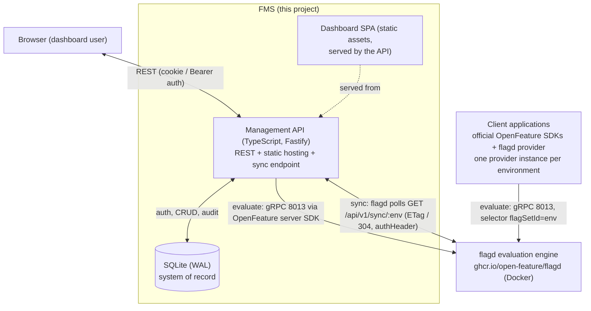
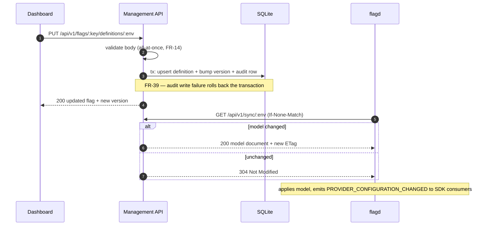
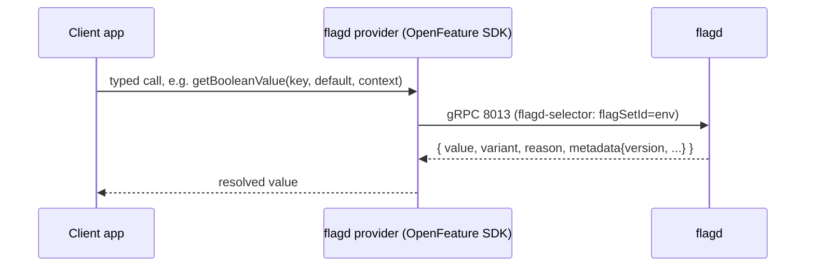
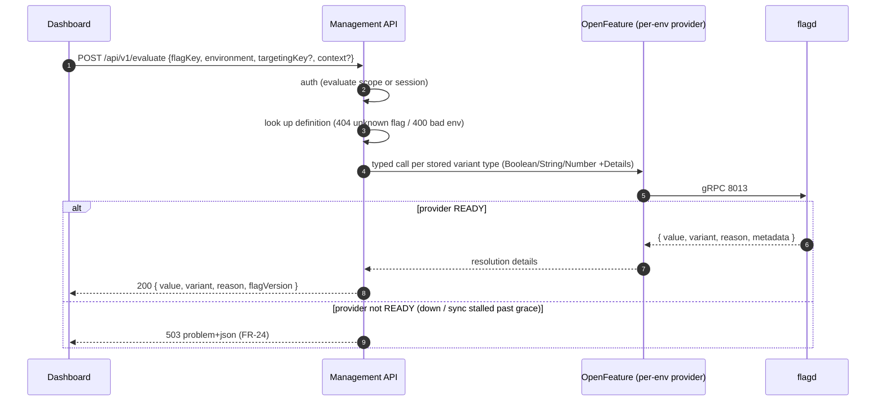

# 02 — Architecture

This document describes the system design of the Flag Management System (FMS). Requirements
referenced as `FR-n` / `NFR-n` live in [01-requirements.md](01-requirements.md). Decisions with
rationale are captured as ADRs in [adr/](adr/).

## 1. System context



Key properties:

- **flagd is the only evaluator.** FMS stores definitions and publishes them; it never computes
  flag values (FR-21). This keeps FMS simple and makes every client language a first-class
  citizen via the official OpenFeature providers.
- **SQLite is the only system of record.** Everything flagd serves is derivable from it
  (FR-28). flagd is stateless from FMS's perspective.
- **The dashboard is a static SPA** served by the management API — one process to run, no
  build step, no separate deployment unit.

## 2. Components

### 2.1 Management API

| Concern | Choice |
| --- | --- |
| Language / runtime | TypeScript on Node.js ≥ 22 (ESM) |
| HTTP framework | Fastify (structured logging, schema validation, static serving) |
| Storage | SQLite via `better-sqlite3` (WAL mode; synchronous API keeps transaction code simple) |
| Sessions | JWT (HS256), 12 h expiry, `HttpOnly`/`SameSite=Lax` cookie + bearer use |
| Flag evaluation client | `@openfeature/server-sdk` + `@openfeature/flagd-provider` (gRPC, `rpc` resolver) |
| Validation | `zod` at the HTTP boundary; domain-level validation in pure functions |
| Testing | `vitest` (unit + integration), Docker-based e2e against a real flagd |

Responsibilities:

1. **REST API** for flags, definitions, keys, audit (contract in [04-api.md](04-api.md)).
2. **Model publication**: pure function `compile(flag, definition, env) → flagd model document`,
   plus the `/api/v1/sync/:env` endpoint with strong ETags (details in
   [03-data-model.md](03-data-model.md)).
3. **Evaluate proxy**: `/api/v1/evaluate` delegating to OpenFeature (one `FlagdProvider`
   instance per environment; each created with `selector: "flagSetId=<env>"`).
4. **Static hosting** for the dashboard SPA.
5. **Audit** on every mutation (append-only table; write-failure aborts the mutation).
6. **Auth**: single admin identity (env-configured) for login; API keys for programmatic access.

Module layout (planned; see NFR-8 — domain logic stays free of framework concerns):

```
server/src/
├── index.ts               # bootstrap: config → db → app → listen
├── app.ts                 # Fastify app factory (routes, plugins, static)
├── config.ts              # env parsing/defaults (pure, testable)
├── db/
│   ├── index.ts           # connection (WAL), migrations
│   └── schema.ts          # DDL
├── domain/
│   ├── flags.ts           # flag/definition validation (pure)
│   ├── rules.ts           # rule model + validation (pure)
│   └── flagd-model.ts     # rule → flagd JSONLogic compiler (pure)
├── evaluate/
│   ├── evaluator.ts       # FlagEvaluator interface + OpenFeature impl (DI seam)
│   └── providers.ts       # per-environment FlagdProvider registry
├── http/
│   ├── auth.ts            # session/api-key middleware, scopes
│   ├── problem.ts         # RFC 9457 helpers
│   └── routes/            # flags, definitions, sync, evaluate, keys, audit, auth
└── static/                # dashboard assets (see 2.3)
```

### 2.2 flagd

Run as a Docker container (`ghcr.io/open-feature/flagd:<pinned tag>`), started via
`docker compose`. Configuration (planned `flagd/config.yaml`, passed with `--config`):

```yaml
sources:
  - uri: http://localhost:3000/api/v1/sync/dev
    provider: http
    interval: 5
    authHeader: "Bearer fms_<SYNC_KEY>"
  - uri: http://localhost:3000/api/v1/sync/staging
    provider: http
    interval: 5
    authHeader: "Bearer fms_<SYNC_KEY>"
  - uri: http://localhost:3000/api/v1/sync/prod
    provider: http
    interval: 5
    authHeader: "Bearer fms_<SYNC_KEY>"
```

Notes (verified against current flagd docs):

- **One HTTP source per environment**, each serving a document whose set-level metadata carries
  `flagSetId: <env>` (ADR-0004). flagd polls each at `interval` (default 5 s) and uses
  `If-None-Match`/`ETag` → `304 Not Modified` when unchanged, so steady-state polling is cheap.
- `authHeader` supplies the complete `Authorization` header value — FMS issues a dedicated
  API key with `sync` scope (FR-27).
- Port map (current flagd): **8013** gRPC evaluation (also serves HTTP JSON at
  `/flagd.evaluation.v2.Service/Resolve*`), **8014** OFREP service, **8015** gRPC sync
  service, **8017** metrics. Exact ports vary by version — pin the image tag in compose and
  verify against that release's docs.
- The flagd image tag is **pinned** in `docker-compose.yml` (upgrades are coordinated: the
  `fractional` hashing scheme changed in flagd v0.18.0, so flagd and providers must be upgraded
  together).

### 2.3 Dashboard

Vanilla TypeScript/JS single-page app in `server/src/static/` (served at `/`), no build step,
no framework:

- `index.html` — shell with hash-routed views: `#/flags`, `#/flags/:key`, `#/evaluate`,
  `#/keys`, `#/audit`; login form when unauthenticated.
- `app.ts` — fetch-based API client (relative `/api/v1/...`, cookie auth), view renderers,
  rule editor (ordered list; drag or up/down controls), playground.
- `styles.css` — hand-rolled, no CSS framework.

Constraints: dashboard JS stays plain and small; any nontrivial pure logic (e.g. local rule
validation before submit) is duplicated from the domain module in a shared, testable place
rather than hidden in DOM code.

### 2.4 Client applications (out of scope, documented pattern)

Server-side clients use the official OpenFeature SDK for their language plus the flagd
provider, configured per environment:

```ts
// Node example (server-side)
import { OpenFeature } from '@openfeature/server-sdk';
import { FlagdProvider } from '@openfeature/flagd-provider';

await OpenFeature.setProviderAndWait(
  new FlagdProvider({ host: 'localhost', port: 8013, selector: 'flagSetId=production' }),
);

const client = OpenFeature.getClient();
const beta = client.getBooleanValue('new-checkout', false, {
  targetingKey: 'user-123',
  email: 'dev@example.com',
});
```

- One provider instance per environment (selector is a constructor option in the Node
  provider; no per-request selector is documented — OQ-1).
- Browsers do **not** evaluate directly in v1 (non-goal); they call their backend.

## 3. Data flows

### 3.1 Definition change → flagd



End-to-end propagation latency ≈ one sync interval (≤ 5 s default; FR-29).

### 3.2 Evaluation (client app)



No FMS process is in this path at runtime (NFR-1 latency budget applies to flagd, which is
co-located).

### 3.3 Evaluation (FMS proxy / dashboard playground)



## 4. Environments as flag sets (ADR-0004)

- Environments (`dev`/`staging`/`prod`) map 1:1 to flagd **flag sets**: the sync document for
  environment `e` carries set-level `"metadata": { "flagSetId": "e" }`.
- flagd's selector mechanism (`flagSetId=<env>`) isolates environments: a provider configured
  with a selector only sees and evaluates that set's flags.
- One flagd instance serves all environments (simpler ops than N containers; isolation is
  logical, enforced by the selector).
- FMS keeps per-environment definitions in one table (unique per flag+env) — storage is
  environment-agnostic; only publication differs per env.

## 5. Rule compilation (overview)

The dashboard's structured rule model (defined in [03-data-model.md](03-data-model.md)) is
compiled to flagd's JSONLogic-based targeting by a pure function in `domain/flagd-model.ts`:

- **No rules** → no `targeting` property (evaluation reason `STATIC`, cacheable by flagd).
- **Attribute rules** → nested `{"if": [cond, variant, next]}` chain; conditions ANDed with
  `{"and": [...]}`; op mapping: `eq→==="`, `neq→!==`, `in→in` (array form),
  `starts_with/ends_with→starts_with/ends_with`, `gt/gte/lt/lte→>,>=,<,<=`,
  `exists→!!` (strict semantics, no type coercion — `===`/`!==` chosen deliberately).
- **Percentage rule (terminal, FR-18)** → the `fractional` custom operation with **no bucketing
  expression**, so flagd uses its default bucketing value `[flagKey, targetingKey]`:
  per-flag independence and sticky assignment by targeting key (FR-19).
- **Fallback** → `defaultVariant` in the flag definition (the final `else` is implicit).

The compiled document must validate against the official JSON schema
(`https://flagd.dev/schema/v0/flags.json`) — enforced by tests with golden files
([05-testing.md](05-testing.md)).

## 6. Security

| Area | Design |
| --- | --- |
| Admin credentials | `ADMIN_USERNAME` / `ADMIN_PASSWORD` from environment. Local-dev defaults exist (`admin` / `dev-insecure-password`) but `app.ts` refuses to boot with defaults when `NODE_ENV=production`. |
| JWT | HS256, secret from `JWT_SECRET` (random at boot with warning when unset, in dev only). Claims: `sub` (username), `type: "session"`, `exp` (12 h). |
| API keys | `fms_` + 32 random bytes (base62). Only SHA-256 stored. Scopes: `manage`, `evaluate`, `sync`, `all`. Resolution order: bearer is a JWT (session) or a key (hash compare, constant-time). |
| Sync endpoint | `sync` scope required (FR-27). flagd is the only expected consumer; key is provisioned in `flagd/config.yaml`. |
| Audit | Append-only table, no update/delete API (FR-37); audit write participates in the mutation transaction (FR-39). |
| HTTP hardening | `HttpOnly` + `SameSite=Lax` session cookie; `application/problem+json` errors leak no internals; no CORS (same-origin dashboard); JSON body size limit (1 MB). |
| Secrets in repo | None. `docker-compose.yml` reads the sync key from the environment. |

Threats explicitly out of scope for v1: transport encryption (assume trusted network / TLS
terminating proxy), rate limiting, PII redaction in audit.

## 7. Observability

- **Logging**: pino (via Fastify), JSON. Every request: id, route, actor (when authenticated),
  status, duration. Domain events (flag created, definition published, key revoked) as
  structured log lines with the audit id.
- **Health**: `GET /healthz` → process alive. `GET /readyz` → `{ status, flagd: { <env>:
  "READY"|"STALE"|"ERROR" } }` derived from OpenFeature provider state events per
  environment. `readyz` is 503 when any environment's provider is not READY.
- **Sync health in the UI** (FR-47): the dashboard compares stored flag `version` with the
  `version` in flagd flag metadata (exposed by the provider on evaluated flags; a
  `/api/v1/flags/:key/observed` helper reads it via a probe evaluation per env) and shows a
  stale badge when they differ.
- **flagd metrics** (8017, Prometheus) are available but not wired into FMS in v1 (non-goal).

## 8. Failure modes & behavior

| Failure | Behavior |
| --- | --- |
| flagd down at boot | API boots; `readyz` 503; `/evaluate` 503 (FR-24); CRUD unaffected. Provider retries per its backoff; `readyz` flips to READY when the gRPC stream establishes. |
| flagd restarts / model resets | flagd re-syncs from FMS within one poll; evaluation unavailable only for that window. |
| FMS API down | flagd keeps serving last synced model (NFR-3). Dashboard/CRUD unavailable. |
| Sync endpoint error (5xx) | flagd keeps last good model, retries on interval. FMS logs the request; a prolonged outage is visible via `readyz` STALE and the UI badge. |
| Concurrent definition edits | Last-writer-wins per (flag, env); the audit log preserves both before/after states. Optimistic locking (version precondition) is a documented v1.1 candidate. |
| SQLite corruption / loss | Backup = copy of the SQLite file (WAL checkpoint first). Documented in runbook. |
| JWT secret rotated | Sessions invalid (re-login). Keys unaffected. |

## 9. Configuration (environment variables)

| Variable | Default | Purpose |
| --- | --- | --- |
| `PORT` | `3000` | HTTP port (API + dashboard + sync) |
| `NODE_ENV` | `development` | `production` enforces no insecure defaults |
| `DATABASE_PATH` | `./data/fms.db` | SQLite file location |
| `ADMIN_USERNAME` / `ADMIN_PASSWORD` | dev defaults (refused in production) | Login credentials |
| `JWT_SECRET` | random per boot (dev warning) | Session signing |
| `FLAGD_HOST` / `FLAGD_PORT` | `localhost` / `8013` | flagd gRPC endpoint for the evaluate proxy |
| `ENVS` | `dev,staging,prod` | Environment list (order = display order) |
| `SYNC_KEY` | — | Pre-seeded `sync`-scoped API key (logged once at first boot, also settable for compose/flagd) |

## 10. Deployment

**Local / single-host (v1 target):**

```
docker compose up -d            # flagd only (image pinned; config from flagd/config.yaml)
npm run dev                     # API + dashboard on :3000, DB in ./data
```

`docker-compose.yml` ships with the repo and contains **flagd only** in v1; the API runs as a
Node process (keeps dev loop simple; a container image for the API is a v1.1 candidate).

**Later (out of scope for v1):** API container image, TLS termination, Postgres, multiple
flagd instances.

## 11. References

- flagd — flag definitions & targeting (JSONLogic, custom operations):
  <https://flagd.dev/reference/flag-definitions/>
- flagd — `fractional` operation: <https://flagd.dev/reference/custom-operations/fractional-operation/>
- flagd — sync configuration (HTTP provider, `authHeader`, `interval`, ETag behavior):
  <https://flagd.dev/reference/sync-configuration/>
- flagd — flag sets & selectors: <https://flagd.dev/guides/migrating-to-flag-sets/>
- flagd — JSON schemas (flags, targeting, config): <https://flagd.dev/reference/schema/>
- flagd — Node.js provider: <https://flagd.dev/providers/nodejs/>
- OpenFeature specification: <https://openfeature.dev/specification/>
