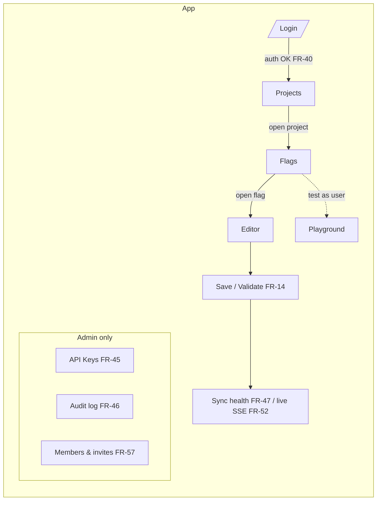
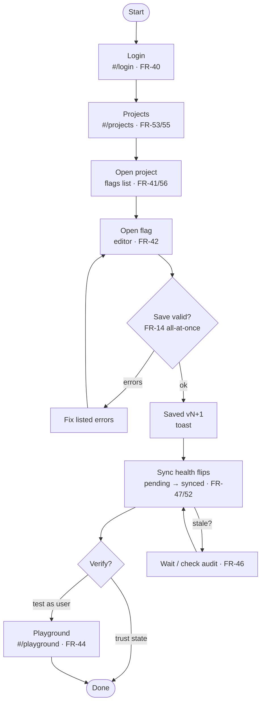
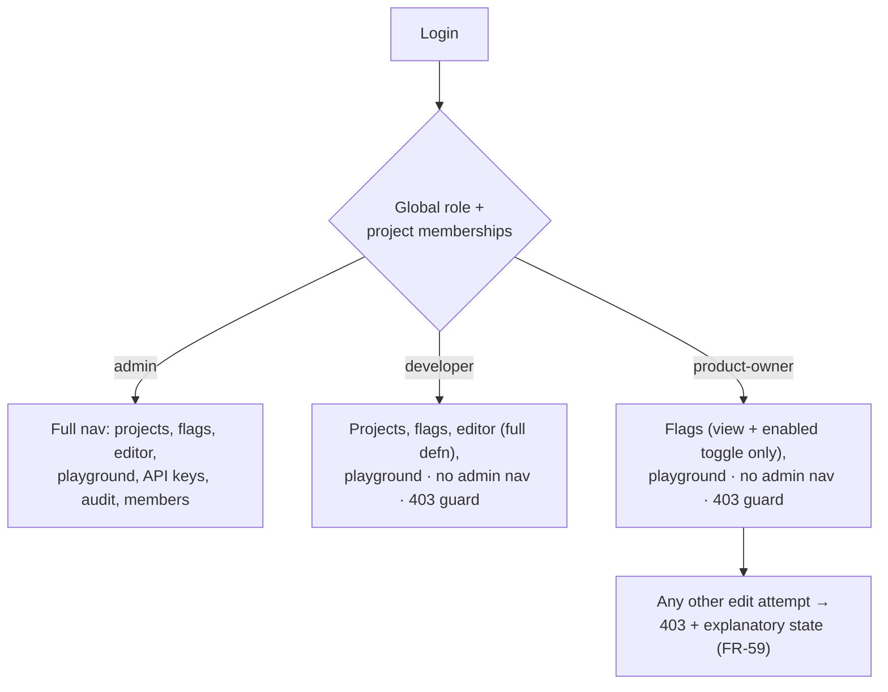

# 07 — Dashboard Design

Design specification for the FMS web dashboard (M4 and beyond). The visual design is being
built in Figma; this document is the source of truth for information architecture, screen
specs, component inventory, design tokens, and user flows. Every screen is traced to the
functional requirements in [01-requirements.md](01-requirements.md) §4.9 / §4.9.1 (FR-40…FR-59)
and the change-event requirements §4.10 (FR-50…FR-52).

**Figma file:** [FMS Dashboard — Design](https://www.figma.com/design/EQJ5mH28fzRW9qzwS8O0Lf)

| Page | Contents |
| --- | --- |
| `00 · Design System` | Token collections (FMS Color / Spacing / Radius), text styles, icon + component library |
| `01 · Screens` | Ten screen frames: Login, Projects, Flags, Flag Editor, Playground, API Keys, Audit, Members, Roles & Permissions, Project Access |
| `02 · User Flow` | Role-based user-flow diagram (main loop + branches) |

> **Status note (2026-11-09):** the Figma canvas build is partially complete — pages, token
> collections, and text styles are on canvas. The remaining build (icons, components,
> screens, flow diagram) is ready-to-run as MCP scripts in
> [`design/figma/`](../design/figma/) and is blocked only by the Figma Starter-plan MCP
> call quota (20/month on a View seat). See
> [§8 — Figma build & resume](#8-figma-build--resume) to finish the canvas.

> **Visual reference (2026-11-09):** the screen language was revised against a
> "FlagOps" reference file (read-only — reviewed from a PNG export, never edited).
> Adopted: light shell with white app rail, `#F8FAFC` canvas + slate neutrals, indigo
> `#4F46E5` accent, card-grid project browsing, per-environment summary cards, inline
> ON/OFF state pills (click-to-toggle), side-drawer flag creation, member Active/Pending
> statuses, and dedicated Roles & Permissions + Project Access screens. Kept
> FMS-specific: per-env versions (FR-41), observed-vs-stored sync health (FR-47), SSE
> live pill (FR-52), definition editor with all-at-once validation (FR-42/FR-14),
> copy-from (FR-43), playground (FR-44), API keys (FR-45), audit (FR-46), invite-only
> auth (FR-57). Palette values marked *sampled* were measured from the export; the rest
> are Tailwind-slate equivalents.

## 1. Design goals

1. **Modern & organized** — a calm, light shell (white app rail on a `#F8FAFC` canvas,
   reference style), one accent (indigo), strict type scale, consistent 8-pt grid.
2. **Intuitive** — the mental model follows the domain hierarchy:
   `project → environment → flag → definition`. Navigation mirrors this hierarchy exactly,
   so users never guess where something lives.
3. **Safe by default** — every mutation is verifiable: sync-health state is always visible,
   the audit trail is one click away, and role boundaries are shown (disabled controls with
   an explanatory note) rather than hidden.
4. **Fast for on-call** — the kill-switch path (open flag → toggle env → save → confirm
   synced) is the shortest flow in the product and must never require more than three
   clicks from the flag list.

## 2. Information architecture

Navigation model (mirrors `web/src/router/index.ts` hash routes):

| Route | Screen | Access (FR-54 matrix) |
| --- | --- | --- |
| `#/login` | Login | public |
| `#/projects` | Projects (home) | all roles |
| `#/projects/:projectId/flags` | Flags list | all roles (project-scoped) |
| `#/projects/:projectId/flags/new` | Flag editor (create) | admin, developer |
| `#/projects/:projectId/flags/:flagKey` | Flag editor | all roles (controls gated) |
| `#/playground` | Evaluate playground | all roles (project-scoped) |
| `#/api-keys` | API keys | admin only |
| `#/audit` | Audit log | admin only |
| `#/guide` | User guide | all roles |
| — (planned) | Members & invites | admin only |
| — (planned) | Roles & permissions (capability matrix) | admin only |
| — (planned) | Project access (`#/projects/:projectId/access`) | admin only |

Shell layout (all authenticated screens):

- **App rail** (232 px, white `bg/surface`, right hairline `border/default`; light shell
  adopted from the reference): logo row, `Projects`, `Playground`; section **ADMIN**
  (admin only): `API Keys`, `Audit Log`, `Members`, `Roles & permissions`; bottom:
  `User guide`, user card (avatar, name, global role tag, sign out). Items 36 px,
  radius 8: default `ink/3` text on transparent, active `side/active` (`#F8FAFC`) bg +
  `ink/1` text.
- **Top bar** (56 px, white, bottom hairline `border/default`): breadcrumb
  (`Projects / Checkout Web / new-payment-flow`), right cluster: `● Live` SSE pill
  (FR-52), project sync badge, avatar menu.
- **Content** (1168 px, canvas `bg/canvas` `#F8FAFC`, padding 32).

## 3. Design tokens

### 3.1 Color (Figma collection `FMS Color`)

Reference palette (slate neutrals + indigo accent). *sampled* = measured from the
FlagOps PNG export; the rest are Tailwind-slate equivalents.

| Token | Hex | Use |
| --- | --- | --- |
| `bg/canvas` | `#F8FAFC` *sampled* | content background |
| `bg/surface` | `#FFFFFF` *sampled* | cards, top bar, rail, inputs |
| `bg/sunken` | `#F1F5F9` | inset areas, table header rows |
| `border/default` | `#E2E8F0` *sampled* | card, input, rail hairlines |
| `border/strong` | `#CBD5E1` | secondary buttons, dividers |
| `border/subtle` | `#EEF2F6` | hairline row separators |
| `ink/1` | `#0F172A` | primary text |
| `ink/2` | `#475569` | secondary text, icon default |
| `ink/3` | `#64748B` | tertiary text, muted icons |
| `ink/4` | `#94A3B8` *sampled* | placeholders, disabled, rail text |
| `ink/5` | `#CBD5E1` | faintest dividers |
| `brand/600` | `#4F46E5` *sampled* | primary buttons, active states, links |
| `brand/700` | `#4338CA` | primary hover |
| `brand/50` | `#EEF2FF` | selected chips, focus tint |
| `brand/100` | `#E0E7FF` | hover tint on selected chips |
| `ok/600` / `ok/100` | `#10B981` *sampled* / `#D1FAE5` *sampled* | ON pill, synced dots, success |
| `ok/700` | `#047857` | text on ok-100 (badges, checks) |
| `warn/600` / `warn/100` | `#D97706` / `#FEF3C7` | stale sync, warnings, pending |
| `warn/700` | `#B45309` | text on warn-100 |
| `bad/600` / `bad/100` | `#EF4444` *sampled* / `#FEE2E2` *sampled* | OFF pill, errors, destructive |
| `bad/700` | `#B91C1C` | text on bad-100 |
| `env/dev` / `-soft` | `#2563EB` / `#DBEAFE` *sampled* | dev environment |
| `env/staging` / `-soft` | `#D97706` / `#FEF3C7` | staging environment |
| `env/prod` / `-soft` | `#DC2626` / `#FEE2E2` | prod environment |
| `role/admin` / `-soft` | `#047857` / `#D1FAE5` *sampled* | admin role tag |
| `role/developer` / `-soft` | `#2563EB` / `#DBEAFE` *sampled* | developer role tag |
| `role/product-owner` / `-soft` | `#7C3AED` / `#F3E8FF` *sampled* | product-owner role tag |
| `status/active` / `-soft` | `#047857` / `#D1FAE5` | signed in at least once |
| `status/pending` / `-soft` | `#B45309` / `#FEF3C7` | invited, temp password not yet used |
| `side/active` | `#F8FAFC` *sampled* | active rail item bg (rail itself is `bg/surface`) |
| `code/bg` / `code/ink` | `#0F172A` / `#E2E8F0` | JSON panels, mono code |

Environment identity is consistent everywhere: chips, dots, table columns, editor tabs,
playground selects, audit rows.

### 3.2 Spacing & radius (`FMS Spacing`, `FMS Radius`)

Spacing: `4 8 12 16 24 32 48 64` (xs…4xl). Radius: `4 8 12 16 full` — inputs/buttons 8,
cards 12, pills full.

### 3.3 Type (Figma text styles)

| Style | Font | Use |
| --- | --- | --- |
| `display` 28/Bold | Inter | screen titles (rare) |
| `h1` 20/Semibold | Inter | page titles |
| `h2` 16/Semibold | Inter | card titles |
| `h3` 14/Semibold | Inter | row titles, nav |
| `body` 14 / `body-sm` 13 | Inter | default UI text |
| `caption` 12 / `caption-strong` | Inter | meta, badges |
| `overline` 11/Semibold +0.8% | Inter | section labels |
| `mono` 13 / `mono-sm` 12 | JetBrains Mono | flag keys, envs, versions, JSON, API keys, audit actions |

## 4. Component inventory (Figma page `00 · Design System`)

| Component | Variants / notes |
| --- | --- |
| `Icon/*` (30 × 2 tones) | Flag, Grid, Play, Key, History, Users, Book, Search, Plus, ChevronDown/Right, Copy, Trash, Check, X, Warning, ArrowRight, Filter, Grip, Eye, Bolt, Logout, Shield, Pencil, External, Refresh, Clock, Inbox, Dot, Promote — tones: on-light `#475467`, on-dark `#9AA5B8` |
| `Button` | Primary, Secondary (bordered), Ghost, Danger; sizes md 36 / sm 30; radius 8; optional 16 px icon |
| `Badge` | Enabled, Disabled, Synced, Stale, Error, Live, Active, Revoked, Pending — pill, 11 px semibold, 6 px status dot (soft bg + `-700` text) |
| `Pill/ON` · `Pill/OFF` | env state cells (§5.3, click-to-toggle): `ok/100`+`ok/600` · `bad/100`+`bad/600` |
| `EnvChip` | Dev / Staging / Prod — env-soft bg, env-color dot + label |
| `RoleTag` | Admin (emerald), Developer (blue), Product Owner (violet) — §3.1 role tokens |
| `Toggle` | On (brand track) / Off (`border/strong`) — 36×20 |
| `Input` / `Select` / `SearchBox` | 36 h, radius 8, label above; Select adds chevron; SearchBox 32 h with icon |
| `Tab` | Active (ink/1 + 2 px brand underline) / Inactive (ink/3) |
| `Card` | surface, 1 px border, radius 12 |
| `StatCard` | overline label + `h1` value + caption sub |
| `SyncBadge` | `Synced v12` (ok) / `Stale v8≠v9` (warn) / `Error` (bad) with Refresh icon |
| `LivePill` | `● Live` (brand-soft) — FR-52 SSE connection state |
| `Avatar` | 24 px circle, initials, neutral bg |
| `TableRow` / header row | 48 h rows, `border/subtle` separators, 12 px cell padding |
| `EmptyState` | 48 px icon + `h3` + caption + optional action |
| `DiffRow` | before (bad-soft, −) / after (ok-soft, +) mono lines for audit & editor validation |
| `AppShell` | composed rail + top bar + content slot (see §2) |

## 5. Screen specifications

### 5.1 Login — `#/login` (FR-40)

- Centered 400 px card on canvas; logo mark + wordmark `FMS — Flag Management`.
- Title `Sign in`, sub `Use your FMS account for this instance`.
- Fields: **Email** (bootstrap admin = env-configured identity, FR-30), **Password**
  (show/hide). Inline field errors; form-level error banner for RFC 9457 problems
  (e.g. `401 invalid_credentials`). Caption under the form: "No self-signup — accounts
  are created by admin invite (FR-57)." (deliberate contrast with the reference, which
  ships a create-account screen).
- Primary button `Sign in`; footer: `Self-hosted instance` + `Need help? Open the user guide`.
- On success: redirect to `#/projects` (existing router behavior).

### 5.2 Projects — `#/projects` (FR-53, FR-55, FR-56)

Card grid (adopted from the reference): 3-per-row grid of project cards on the canvas.
Toolbar row: page title `Projects` + SearchBox + `N projects` caption; `New project`
primary button (admin only; caption note for other roles: "Creating projects requires
the admin role").

- **Project card** (surface, `border/default`, radius 12): name `h3` + key (mono,
  `ink/4`) with copy icon; EnvChip row (`dev staging prod` seeded per FR-6/FR-55 plus
  any custom); hairline divider; footer: flag count (`24 flags`), per-env sync mini
  dots (ok/warn/bad, tooltip "staging flagd observed v8, stored v9"), last change
  (time + actor, caption).
- Card click → `#/projects/:id/flags`. Card menu (⋯): Open flags, Open playground
  (admin/dev).
- Empty state: Flag icon + `No projects yet` + `Create your first project` (admin) /
  `Ask an admin to create a project` (others).

### 5.3 Flags — `#/projects/:projectId/flags` (FR-41, FR-47, FR-52, FR-56, FR-59)

- Breadcrumb `Projects / {project}` + `● Live` pill top-right (FR-52 — the list, pills,
  and sync cards update without polling).
- **Environment summary cards** (one card per environment; adopted from the reference,
  reworded to sync-health semantics): EnvChip, enabled count (`12 of 24 enabled`), and
  the env's SyncBadge — `Synced v12` (“flagd observed v12 = stored v12”) vs
  `Stale v8 ≠ v9` (“flagd last observed 12:02”, FR-47) vs `Error`.
- Toolbar: SearchBox (`Search flags…`), env filter segment (All / Enabled in dev / …),
  `New flag` button (admin/dev; disabled + note for PO) — opens the **Create flag
  drawer** below.
- **Flag list** (FR-41), one row per flag — flags are project-level and exist in every
  environment (FR-56); state is per-env:
  - **Flag key** (mono + copy icon), **Description** (body, ellipsis).
  - Per-environment **state cell** (Dev / Staging / Prod + custom envs): an inline
    `ON` pill (`ok/100` bg, `ok/600` text) or `OFF` pill (`bad/100` bg, `bad/600` text)
    with the per-env version `v12` (mono) beneath — FR-41. The pill is the inline
    toggle: for roles allowed to toggle (admin, developer, product-owner — FR-58/FR-59)
    a click flips the state and saves; for other roles it is disabled with a 403 note.
    Stale envs get a warn ring on the pill.
  - **Updated** (time + actor), **Actions** (menu: Open, Copy to…, Delete [admin]).
  - Row click (key) → editor. This keeps the kill-switch path two clicks from the list.
- **Create flag drawer** (side drawer over the list; adopted from the reference):
  `Name` input with a **live auto-generated key preview** (mono, kebab-case —
  `New payment flow` → `new-payment-flow`), editable, unique per project (409 on
  clash); `Description` textarea; `Create` → opens the editor for the new flag
  (all envs start disabled, FR-56). The list stays visible behind the drawer.

### 5.4 Flag editor — `#/projects/:projectId/flags/:flagKey` (FR-42, FR-43, FR-14, FR-59)

Two-column layout: **left rail 280 px** (flag meta), **main column** (definition per env).

Left rail `Flag` card:
- Key (mono, copy), Description textarea (admin/dev editable), meta rows: Version `v9`,
  Project, Created. Danger zone: `Delete flag` (admin/dev only) with confirm.

Main column:
1. **Env tabs** (dev / staging / prod / custom) — switching tabs never affects other envs
   (FR-8 isolation); tab shows enabled dot + version.
2. **Definition card** for selected env:
   - Header: `Definition · staging` + **Enabled** Toggle (right). PO may use this toggle
     only (FR-59); all other controls disabled for PO with note
     “Product owner access: you can change the enabled state only.”
   - **Variants** table: name (mono), value (mono), type badge (boolean|string|number),
     add-row / delete-row (dev+).
   - **Default variant** Select (fallback for unmatched rules, FR-42).
   - **Rules** (ordered list, FR-42): each row = Grip (reorder) + rule name + condition
     chips (`email ends-with @acme.com`) or `Percentage split 50% · key user_id` +
     target variant Select + delete; `Add rule` button (dev+).
3. **Copy from… [dev ▾]** menu next to `Save` (FR-43/FR-9) — full replacement of the
   target definition, audited as its own change; confirm dialog states the target.
4. **Sticky save bar**: `Discard` ghost + `Save changes` primary. On invalid submit the
   bar expands into an **all-at-once validation panel** (FR-14): numbered error list
   (e.g. “Rule 2: attribute `plan` is not an allowed context key”,
   “Default variant must be one of the defined variants”) — no single-error-at-a-time.
5. After save: toast `Saved · staging v9 → v10` and sync badges flip to *pending → synced*
   as flagd observes the model (FR-52).

### 5.5 Evaluate playground — `#/playground` (FR-44)

Two cards side by side (55% / 45%):

- **Configure**: Project Select → Flag Select (mono list) → Environment (EnvChips
  selectable) → **Targeting key** input (helper text: “Required for percentage-split
  rules; FMS evaluates sticky by this key”) → **Context** JSON textarea (mono, sample
  `{"country":"FR","plan":"pro"}`) → `Evaluate` primary.
- **Result**: large value (mono, 24 px, variant-colored), variant Badge, **Reason**
  line (`MATCHED_RULE · rule 2 (EU users)` / `DEFAULT` / `DISABLED` / `ERROR`), meta row
  `staging · v9 · 8 ms`, actions: `Copy OpenFeature snippet` (ghost, shows the standard
  OpenFeature + flagd provider code for this project/env) and `Retry`.
- States: no flag selected → EmptyState; evaluation error (provider not ready) → bad
  panel with `provider-error` hint linking to sync health.

### 5.6 API keys — `#/api-keys` (FR-45, admin only)

- Header + `Create key`. Caption: “Keys authenticate `sync` and `evaluate` endpoints for
  flagd and SDK clients.”
- Table: **Name**, **Scope** (badges `sync` / `evaluate`), **Created**, **Last used**
  (`2 min ago` / `—`), **Status** (`Active` / `Revoked`), **Actions** (`Revoke` danger,
  confirm dialog).
- **Create flow**: modal (name + scope checkboxes) → success state replaces modal content:
  one-time plaintext key (mono, Select-all, Copy button) + warning banner
  “This is the only time the key is shown — its hash is stored (FR-45).”

### 5.7 Audit log — `#/audit` (FR-46, admin only)

- Filter bar: Actor, Action, Entity, Environment Selects + date range.
- Table: **Time** (mono), **Actor** (avatar + name), **Action** (mono badge,
  e.g. `flag.definition.update`), **Entity** (flag key / project / user), **Env**
  (EnvChip or —), **Diff** (expand chevron).
- Expanded row: two-column before/after mono diff (red/green), e.g.
  `enabled: true → false` or rule-list changes.
- Pagination footer: `1–20 of 214 · Prev / 1 2 3 … / Next`.
- Append-only: no edit/delete affordances anywhere in the view.

### 5.8 Members & invites — admin only (FR-57, FR-54)

- Header + `Invite user`. Table: **User** (avatar + email), **Status** — `Active`
  (signed in at least once) / `Pending` (invited, temp password not yet used; amber),
  **Global role** (RoleTag), **Project roles** (chips `checkout-web: developer`, …),
  **Last active**, **Actions** (`Re-invite` — reissues temp password; updates global
  role + memberships per FR-57).
- **Invite modal**: Email input; **Global role** Select (admin / developer /
  product-owner); **Project roles** matrix — rows = projects, columns =
  `admin | developer | product-owner | —` (radio per row); submit.
- **Success state**: one-time temporary password (mono, Copy) + banner
  “Shown once — only its hash is stored. The user signs in with it (FR-31, FR-57).”
  Re-inviting an existing user updates role/memberships and reissues the password.
- Caption under the table: the full capability matrix from FR-54/FR-58/FR-59 (link out to
  the requirements doc) — this is also the reference for disabled-control states in other
  screens.

### 5.9 Roles & permissions — admin only (FR-54, FR-58, FR-59)

A dedicated, read-only capability-matrix screen (adopted from the reference; cells
corrected to the requirements). Rows = capabilities with scope, columns = the three
global roles. This is the in-product source of truth for what each role can do —
disabled controls on other screens mirror these cells.

| Capability | Scope | admin | developer | product-owner |
| --- | --- | --- | --- | --- |
| Create projects | global | ✓ | — | — |
| Invite members / assign projects | global | ✓ | — | — |
| Manage API keys | global | ✓ | — | — |
| Read audit | global | ✓ | — | — |
| Create project environments | project | ✓ | ✓ | — |
| Create flags, edit description | project | ✓ | ✓ | — |
| Delete flags | project | ✓ | — | — |
| Create / edit / copy definitions (variants, rules, default) | project | ✓ | ✓ | — |
| Toggle a flag's `enabled` state | project | ✓ | ✓ | ✓ |
| View flags and definitions | project | ✓ | ✓ | ✓ |
| Evaluate flags (playground/API) | project | ✓ | ✓ | ✓ |

✓ = allowed (soft-emerald check cell), — = not allowed. Footer note: "Effective
permission = global role ∪ per-project grants — a membership can elevate a user on
that project but never reduce the global role (FR-54). Product-owner toggles change
`enabled` only (FR-59). Full matrix:
[01-requirements.md §4.9.1](01-requirements.md)."

### 5.10 Project access — `#/projects/:projectId/access`, admin only (FR-54, FR-57)

Per-project membership management (adopted from the reference's project-access screen):

- **Policy card** (top, shield icon): "Restricted by default — only invited members
  with a role on this project can act on it. Effective permission is the union of the
  global role and this project's role; a project role can elevate, never reduce
  (FR-54). A project `admin` role grants project-scoped admin only."
- **Member table**: **User** (avatar + email), **Status** (Active/Pending),
  **Global role** (RoleTag), **Role on this project** — a per-member Select
  (`admin | developer | product-owner | no access`); this is the per-project grant,
  independent of the global role (FR-57). **Actions**: `Remove from project`.
- `Add member` → modal: pick an existing user **or** type a new email (goes through
  the standard invite — one-time temp password, FR-57) + the role for this project.

## 6. User flows

### 6.1 Main operator loop (all roles)

### 6.2 Role gate after login (FR-54/FR-58/FR-59)

### 6.3 Branch flows

```mermaid
flowchart LR
  subgraph Promotion ["Promotion · FR-43/FR-9"]
    P1["dev definition ready"] --> P2["Copy from… dev → staging"]
    P2 --> P3["staging verified<br/>(playground / observed)"]
    P3 --> P4["Copy from… staging → prod"]
    P4 --> P5["Each copy is its own<br/>audited change"]
  end
  subgraph KillSwitch ["Kill switch (on-call) · FR-59"]
    K1["Prod incident"] --> K2["Flag → prod tab"]
    K2 --> K3["Enabled toggle → off"]
    K3 --> K4["Save"]
    K4 --> K5["Confirm synced<br/>(stale → synced)"]
    K5 --> K6["Audit row proves<br/>who/when"]
  end
  subgraph Invite ["Invite · FR-57"]
    I1["Admin → Members"] --> I2["Invite: email +<br/>global + per-project roles"]
    I2 --> I3["Temp password shown once<br/>status: Pending"]
    I3 --> I4["User signs in → scoped session FR-53<br/>status: Active"]
  end
  subgraph Keys ["API keys · FR-45"]
    A1["Admin → API Keys"] --> A2["Create: name + scopes"]
    A2 --> A3["Plaintext shown once"]
    A3 --> A4["flagd sync / SDK evaluate<br/>use the key"]
    A4 --> A5["Revoke when rotated"]
  end
  subgraph NewProject ["New project · FR-55"]
    N1["Admin → Projects → New"] --> N2["name + key (unique, 409 on clash)"]
    N2 --> N3["Seeded dev/staging/prod<br/>+ optional custom envs"]
    N3 --> N4["Create first flag"]
  end
```

### 6.4 Flow → screen map

| Flow | Entry | Screens touched | Exit / proof |
| --- | --- | --- | --- |
| Main loop | Login | Login → Projects → Flags → Editor | synced badge, version bump |
| Kill switch | Flags (prod) | Flags → Editor (enabled) | stale→synced, audit row |
| Promotion | Editor | Editor (Copy from…) ×n | per-copy audit rows |
| Test as user | Flags or Editor | Playground | value/variant/reason |
| Invite | Members | Members → modal | one-time temp password |
| API keys | API keys | API keys → modal | one-time plaintext key |
| New project | Projects | Projects → modal | seeded env set |

## 7. Requirement alignment matrix

| Req | Surface in the design |
| --- | --- |
| FR-40 | §5.1 Login (form → session cookie, error banner) |
| FR-41 | §5.3 flag table: key, description, per-env enabled + version |
| FR-42 | §5.4 editor: toggle, variant table, default selector, ordered rules, all-at-once validation panel |
| FR-43 | §5.4 “Copy from…” menu + confirm (full replacement, own audit entry) |
| FR-44 | §5.5 playground: flag+env, targetingKey, context JSON → value/variant/reason; key-required hint |
| FR-45 | §5.6 keys table + create (one-time plaintext) + revoke |
| FR-46 | §5.7 paginated audit with filters and expandable before/after diff |
| FR-47 | §5.3 per-env sync badges (observed vs stored version, stale indicator) |
| FR-52 | §2 `● Live` pill; §5.3/§5.4 list + badge live update without polling |
| FR-53 | §5.1 login per user; §5.8 invites create scoped sessions |
| FR-54 | §5.9 capability-matrix screen (correct cells + scope column); §5.8/§5.10 role tags & per-project grants; disabled-control states everywhere |
| FR-55 | §5.2 project env chips (seeded dev/staging/prod + custom) |
| FR-56 | §5.3/§5.4 project-scoped flags with per-env unique state |
| FR-57 | §5.8 invite modal + Active/Pending statuses; §5.10 add-member / per-project role override (one-time temp password) |
| FR-58 | §5.3/§5.4 developer: create envs/flags, edit definitions, toggle |
| FR-59 | §5.4 PO: enabled toggle only, other controls disabled + note; 403 state |

Out-of-scope visuals (v1 non-goals, §2 of the requirements): no scheduling UI, no
approval workflows, no flag ownership, no observability dashboards, no browser-side
evaluation client UI.

## 8. Figma build & resume

The canvas is built with the Figma MCP `use_figma` tool. What is already on canvas in the
file linked above:

- Pages `00 · Design System`, `01 · Screens`, `02 · User Flow`
- Variable collections: `FMS Color` (pre-reference values — `00-tokens.js` refreshes them), `FMS Spacing` (8), `FMS Radius` (5)
- Text styles: `display h1 h2 h3 body body-sm caption caption-strong overline mono mono-sm`

Remaining build, as ready-to-run scripts in [`design/figma/`](../design/figma/) (run in
order; each script is a single `use_figma` `code` payload, idempotent where practical):

| Script | Builds |
| --- | --- |
| `00-tokens.js` | Refresh `FMS Color` values to the reference palette (find-by-name, add missing, drop deprecated) |
| `01-icons.js` | 30 icon components × 2 tones in sections on `00` |
| `02-atoms.js` | Button, Badge (+Pending), Pill/ON·OFF, EnvChip, RoleTag, Toggle, Input/Select/SearchBox, Tab, Card, StatCard, LivePill, Avatar, EmptyState, DiffRow |
| `03-shell.js` | Light `Rail`, `Topbar`, `AppShell` composed frame (1440×900) |
| `04-screens-a.js` | Login, Projects (card grid), Flags (env summary cards + inline ON/OFF pills + create-flag drawer) |
| `05-screens-b.js` | Flag editor, Playground frames |
| `06-screens-c.js` | API keys, Audit, Members (Active/Pending) frames |
| `07-screens-d.js` | Roles & permissions matrix, Project access frames |
| `08-user-flow.js` | Role-based flow diagram on `02 · User Flow` |

> These scripts target the exact Figma Plugin API revision observed in this file
> (notably: `createVariable(name, collection, type)` + `setValueForMode`, vector paths as
> `{windingRule, data: "<svg path string>"}` with `M/L/C/Z` commands only, no
> `lineCap`/`lineJoin` on `VECTOR`, `createAutoLayout()`). If Figma changes the API, fix
> the script per the `safeToRetryWithoutCanvasRead` guidance.
